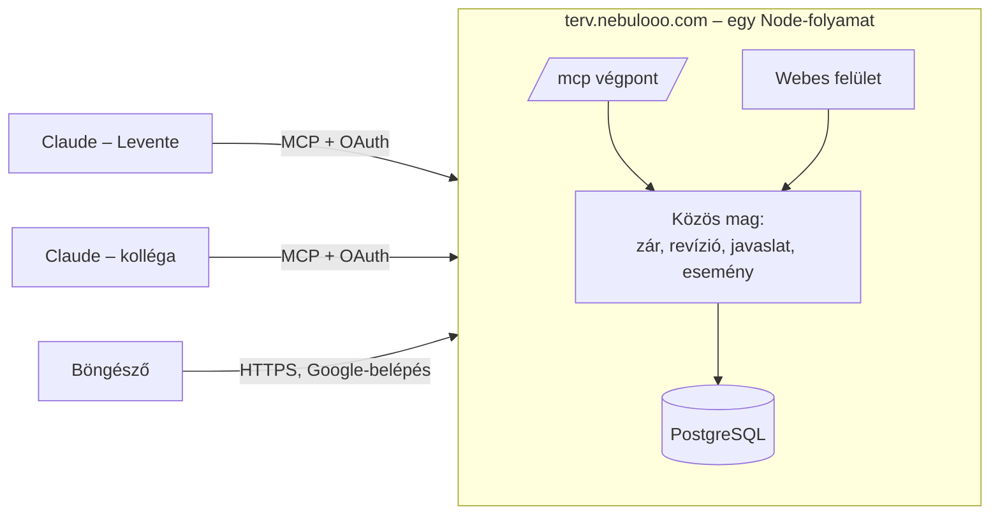

# Közös tervezőapp – specifikáció

Munkanév: `kozos-terv` · Cím: `https://terv.nebulooo.com` · Utolsó frissítés: 2026-11-11

> Forrás: a „Közös tervezőapp – terv és útmutató” Claude-dokumentum, a 2026-11-11-i döntésekkel
> (TypeScript-stack Django helyett, Google-belépés, otthoni szerver Cloudflare Tunnellel).

## 1. Cél és alapelvek

Egy saját webes munkatér, amelyben több ember a **saját Claude-előfizetésével** tervez és ötletel
egy közös projekten, és a Claude-ok nem írják felül egymás munkáját. Az app maga nem hív AI-t:
a Claude hívja az appot MCP-n keresztül, ezért nincs API-költség, csak a szerver üzemeltetése.

Amit a Notion és a Google Docs nem adott meg:

- **Nincs tagdíj és blokklimit.** Annyi tag és tartalom, amennyit a szerver elbír.
- **A zár a szerveren van, nem becsületbeli.** A szerver utasítja el az ütköző írást.
- **A Claude-nak szabott eszközök.** Egy hívással megkapja a projekt állását, csak azt olvassa,
  ami kell, és látja, mi változott a legutóbbi látogatása óta.
- **Mindenki a saját fiókjával lép be.** Minden módosításnál látszik, ki csinálta, és hogy
  ember vagy Claude volt-e.

Négy alapelv:

1. **Szakasz a legkisebb szerkeszthető egység.** A zár, a verzió és a változásnapló szakaszonként működik.
2. **Semmi nem vész el.** Minden írás új revízió, a régi visszaállítható; törlés csak lomtárba.
3. **A fő terv védett, az ötletelés szabad.** A „fő terv” típusú dokumentumokba a Claude csak
   javaslatot tesz, amit ember fogad el; a jegyzetekbe, kutatásba és ötletekbe szabadon ír.
4. **Kicsi és saját.** Egy TypeScript-projekt, Postgres, Docker Compose; nem függ külső
   szolgáltatótól (a Google csak a belépéshez kell).

## 2. Hogyan működik

A Claude-ok és az emberek két külön bejáraton jönnek, de minden írás ugyanabban a **közös magban**
(`src/lib/server/core`) dől el: ott van a zár, a revíziószám és a javaslatok kezelése.
Se az MCP-réteg, se a felület nem ír közvetlenül az adatbázisba.

## 3. Döntések

| # | Kérdés | Döntés |
|---|---|---|
| 1 | Önálló vagy beépített? | Önálló app, saját repó (`tubegamevideo-coder/kozos-terv`) |
| 2 | Hol fut? | Otthoni szerver, Cloudflare Tunnel → `terv.nebulooo.com` |
| 3 | Kik használják? | Meghívásos, több munkateres; először a fejlesztő és a kolléga |
| 4 | Mi védett? | A „fő terv” típusú dokumentumok |
| 5 | Emberi szerkesztő? | Egyszerű Markdown-szerkesztő (szövegdoboz + előnézet), nem WYSIWYG |
| 6 | Webes belépés | Google-fiók (magán Gmail) → OAuth-képernyő „External”, tesztmódban, a tagok tesztfelhasználók; callback: `/api/auth/callback/google` |
| 7 | Zár alapideje | 20 perc, meghosszabbítható (max. 120 perc) |
| 8 | Név és domain | `kozos-terv`, `terv.nebulooo.com` |
| 9 | Stack | TypeScript full-stack (lásd 8. fejezet), nem Django |
| 10 | Első éles projekt | A pályázatfigyelő app tervezése |

Szándékosan kimarad az első változatból: élő karakterszintű közös szerkesztés, képfeltöltés,
mobilapp, e-mail-értesítés, saját AI-hívás a szerverből.

## 4. Adatmodell

A központi elem a **szakasz**, mert ott van a zár és a verzió.

| Tábla | Mit tárol | Megjegyzés |
|---|---|---|
| `user` | Név, e-mail, kép | Google-belépéskor jön létre (meghívóval) |
| `session`, `oauth_client`, `oauth_code`, `oauth_token` | Webes munkamenet és OAuth | Csak a tokenek hash-e |
| `workspace` | Csapat (pl. Fabak) | Egy telepítésen több munkatér |
| `workspace_member` | Tag + szerepkör: `owner`, `editor`, `viewer` | |
| `invitation` | E-mail, munkatér, szerepkör, lejárat | Ezzel engedi be a Google-belépés |
| `project` | Név, egymondatos cél, állapot, **projektutasítás** | A projektutasítás a Claude-nak szóló szabályok |
| `document` | Cím, típus (`main_plan`, `note`, `research`, `decision_log`), védett-e, lomtárban-e | Védettbe a Claude csak javasol |
| `section` | Cím, Markdown, sorrend, aktuális revíziószám, lomtárban-e | A legkisebb szerkeszthető egység |
| `section_revision` | A szakasz minden állapota: tartalom, ki, mikor, ember vagy Claude, indoklás | Előzmény, diff, visszaállítás |
| `section_lock` | Szakasz, ki tartja, mikor jár le, mit csinál | Lejár magától, a szerver ellenőrzi |
| `proposal` | Szakasz, alaprevízió, javasolt tartalom, indoklás, állapot | `open`, `accepted`, `rejected`, `conflicted` |
| `comment` | Szál szakaszon vagy kérdésen, válaszokkal, lezárható | Itt zajlik a vita |
| `question` | Kérdés, állapot, ki vetette fel, döntés, kapcsolódó szakaszok | `open`, `disputed`, `decided` |
| `idea` + `idea_vote` | Rövid ötlet, szerző, címkék, szavazatok, állapot | `new`, `investigating`, `adopted`, `rejected` |
| `event` | Minden változás: ki, mit, min, mikor, ember vagy Claude | „Mi változott, mióta itt voltam” |
| `project_visit` | Utolsó látogatás felhasználónként és projektenként, csatornánként | Ebből jön a „változások óta” |

Minden revízión és eseményen ott van az **`actor_kind`** (`human` vagy `claude`). A Claude
MCP-n keresztül érkezik, így a szerver tudja: a belépett felhasználó, a Claude-ján keresztül.

## 5. Ütközéskezelés

Három réteg véd a felülírás ellen, mindhármat a szerver kényszeríti ki, adatbázis-tranzakcióban,
a szakasz sorát `SELECT … FOR UPDATE`-tel zárolva.

1. **Revíziószám minden írásnál.** Aki ír, megadja, melyik revíziót olvasta (`baseRevision`).
   Ha közben más módosította, az írás `STALE_REVISION` hibát kap, a válaszban a friss tartalommal
   és a különbséggel (unified diff). Ez önmagában megakadályozza az elveszett munkát.
2. **Szakaszzár lejárattal.** Hosszabb munka előtt a Claude lefoglalja a szakaszt (20 perc,
   meghosszabbítható). Amíg él, más nem írhat bele (`SECTION_LOCKED`, a válaszban ki tartja és
   meddig), csak megjegyzést tehet. A zár magától lejár.
3. **Javaslat mód a védett dokumentumokban.** A Claude a védett dokumentumba javaslatot tesz
   indoklással; ember elfogadja vagy elutasítja. Ha az alaprevízió közben elavult, a javaslat
   `conflicted` lesz, és újra kell alapozni.

Szabályok:

- **A kis íráshoz nem kell zár**, elég a revíziószám; a zár a több lépéses átíráshoz való.
- **Célzott módosítás az alap**: keresés-csere (régi szöveg → új szöveg); a régi szövegnek
  pontosan egyszer kell szerepelnie. Az egész szakasz cseréje külön művelet.
- **A zárat a munkatér tulajdonosa is feloldhatja**, naplózva.
- **Ember írhat védett dokumentumba közvetlenül**; a javaslatkényszer a Claude-ra vonatkozik.
- **Minden írás indoklást kér** (`reason`), ez a revízióba kerül.

## 6. MCP-felület

Távoli MCP-szerver Streamable HTTP-n a `/mcp` címen, a hivatalos `@modelcontextprotocol/sdk`
web-standard transportjával, állapotmentesen. A legfontosabb eszköz a `get_project_brief`:
egyetlen hívással megmondja, hol tart a projekt, és mi változott a legutóbbi látogatás óta.

| Csoport | Eszköz | Mit csinál |
|---|---|---|
| Tájékozódás | `list_projects` | A felhasználó projektjei |
| Tájékozódás | `get_project_brief` | Projektutasítás, tartalomjegyzék, nyitott kérdések, aktív zárak, nyitott javaslatok, változások az utolsó látogatás óta |
| Tájékozódás | `get_changes` | Változások egy időpont vagy kurzor óta, diffekkel |
| Tájékozódás | `search` | Teljes szöveges keresés (Postgres FTS), találatonként szakasz és részlet |
| Olvasás | `read_document` | Vázlat vagy teljes tartalom, szakaszonként revíziószámmal |
| Olvasás | `read_section` | Tartalom, revízió, zár, nyitott javaslatok |
| Írás | `edit_section` | Keresés-csere, `baseRevision` kötelező |
| Írás | `replace_section` | Egész szakasz cseréje, `baseRevision` kötelező |
| Írás | `create_section`, `create_document` | Új szakasz vagy dokumentum |
| Írás | `propose_change` | Javaslat védett szakaszhoz, indoklással |
| Zár | `lock_section`, `release_section` | Foglalás lejárattal, feloldás |
| Vita | `add_comment`, `list_comments` | Megjegyzés és válasz |
| Kérdések | `add_question`, `update_question` | Új kérdés; állapot és döntés |
| Ötletek | `add_idea`, `list_ideas`, `vote_idea` | Gyors ötletek, szavazás |
| Napló | `log_decision` | Döntés a döntésnaplóba |

Irányelvek: a leírások tanítanak (mikor kell használni, mi előzze meg); a hibaüzenet segít
(friss szöveg + diff, ki tartja a zárat); rövid válaszok (alapból vázlat); minden írás indoklást
kér. Később MCP-promptok (pl. „ötletelés egy kérdésről”) és MCP Apps (javaslat-elfogadó a chatben).

## 7. Hitelesítés és biztonság

- **Webes belépés:** Google OpenID Connect (kód + PKCE), saját munkamenet-sütivel. Csak az
  léphet be, aki már tag, vagy akinek érvényes meghívója van (meghívó: e-mail + szerepkör, 14 nap).
- **Claude-csatlakozó:** a szerver maga az OAuth 2.1 hitelesítési szerver, saját, kis kóddal
  (`src/lib/server/auth/oauth.ts`; a Better Auth OAuth-modulja túl nagy és nehezen átlátható lett
  volna): dinamikus kliensregisztráció (RFC 7591), PKCE S256 kötelező, frissítő token forgatással
  és újrahasználat-észleléssel, erőforrás-kötés (RFC 8707), metaadat
  (`/.well-known/oauth-authorization-server`, `/.well-known/oauth-protected-resource/mcp`).
  Átlátszatlan tokenek, az adatbázisban csak a hash-ük; a visszavonás azonnali.
- **Visszahívási cím:** `https://claude.ai/api/mcp/auth_callback`.
- **Nyilvános elérés kell:** a claude.ai az Anthropic felhőjéből hív, ezért Tailscale mögött nem
  működik; Cloudflare Tunnel jó, de Cloudflare Access interaktív beléptetés nem lehet előtte.
- **Rövid életű hozzáférési token** frissítő tokennel; a felületen a kapcsolódott kliensek
  láthatók és visszavonhatók.
- **Jogosultság minden hívásnál** a közös magban: munkatér-tagság és szerepkör (`viewer` nem ír).
- **Mentés** naponta a NAS-ra (`pg_dump`).
- A Claude Code ugyanehhez kapcsolódik: `claude mcp add --transport http kozos-terv https://terv.nebulooo.com/mcp`.

## 8. Technikai stack

| Réteg | Választás | Miért |
|---|---|---|
| Nyelv, futtatás | TypeScript, Node 22 | Egy nyelv a szervertől a felületig; az MCP SDK TS-ben a legérettebb |
| Webes keret | SvelteKit (`adapter-node`) | Szerveroldali renderelés + API-útvonalak egy folyamatban, kevés boilerplate |
| Adatbázis | PostgreSQL 16 + Drizzle ORM, `postgres` (postgres.js) driver | Típusos séma, SQL-közeli, migrációk |
| Keresés | Postgres teljes szöveges keresés | Később pgvector |
| Élő frissítés | Server-Sent Events, Postgres `LISTEN/NOTIFY`-jal | Egyszerű, egy irányú, proxybarát |
| Markdown | `marked` + `DOMPurify` szerveroldalon; Mermaid a böngészőben | A Claude Markdownban ír, Mermaidben rajzol |
| MCP | `@modelcontextprotocol/sdk`, `WebStandardStreamableHTTPServerTransport` | Hivatalos, a SvelteKit Request/Response-ával megy |
| Belépés, OAuth | Google OIDC + saját OAuth 2.1 szerver | Kicsi, átlátható, teljesen tesztelt; nincs külső függőség |
| Diff | `diff` (jsdiff) | Unified diff az ütközési válaszokhoz |
| Validálás | `zod` | MCP-eszközök bemenete |
| Tesztek | Vitest valódi Postgresen | A zár- és tranzakciólogika csak valódi DB-n bizonyítható |
| Telepítés | Docker Compose: app, Postgres, mentés | |
| Elérés | Cloudflare Tunnel (`cloudflared` konténer) | |

## 9. Webes felület

Az embereknek szól: elolvasni, átnézni, dönteni. Magyar felület, sűrű elrendezés, sötét mód.

| Képernyő | Mit mutat | Mit lehet csinálni |
|---|---|---|
| Projektlista | Munkaterek, projektek, utolsó változás, nyitott javaslatok | Új projekt, meghívás |
| Projekt-irányítópult | Változások az utolsó látogatás óta, aktív zárak, nyitott javaslatok és kérdések | Ugrás a változáshoz |
| Dokumentum | Szakaszok renderelve, zárjelzés, revíziószám | Szerkesztés, megjegyzés, előzmény |
| Javaslatok | Diff, indoklás, szerző | Elfogad, elutasít, megjegyzés |
| Előzmény | Revíziók, ember/Claude jelöléssel, diff | Visszaállítás |
| Kérdések | Tábla állapot szerint | Állapot, döntés, vita |
| Ötletek | Kártyák címkékkel, szavazatokkal | Szavazás, beemelés, elvetés |
| Beállítások | Tagok, szerepkörök, Claude-kliensek, projektutasítás | Meghívás, visszavonás |

Export Markdownba (később git-tükör), import Markdownból.

## 10. MVP és lépések

Minden lépés végén egy kipróbálható kapu dönti el, hogy mehet-e a következő.

1. **Adatmodell és közös mag.** *Kész, ha* a tesztek bizonyítják, hogy elavult revízióra és
   foglalt szakaszra az írás elutasítást kap, párhuzamos írásnál pontosan egy nyer, és a védett
   dokumentumba a Claude nem írhat közvetlenül.
2. **MCP-szerver helyben, belépés nélkül** (csak localhost, fejlesztői felhasználóval).
   *Kész, ha* az MCP Inspectorból és Claude Code-ból minden eszköz működik.
3. **Google-belépés, OAuth és DCR, nyilvános címen.** *Kész, ha* a claude.ai-ban felvett egyedi
   csatlakozó belép, és a hívások a saját felhasználóhoz kötődnek.
4. **Webes felület:** irányítópult, dokumentum, javaslatok, előzmény, élő frissítés.
5. **Import, meghívás, éles próba** a pályázatfigyelő app tervével.
